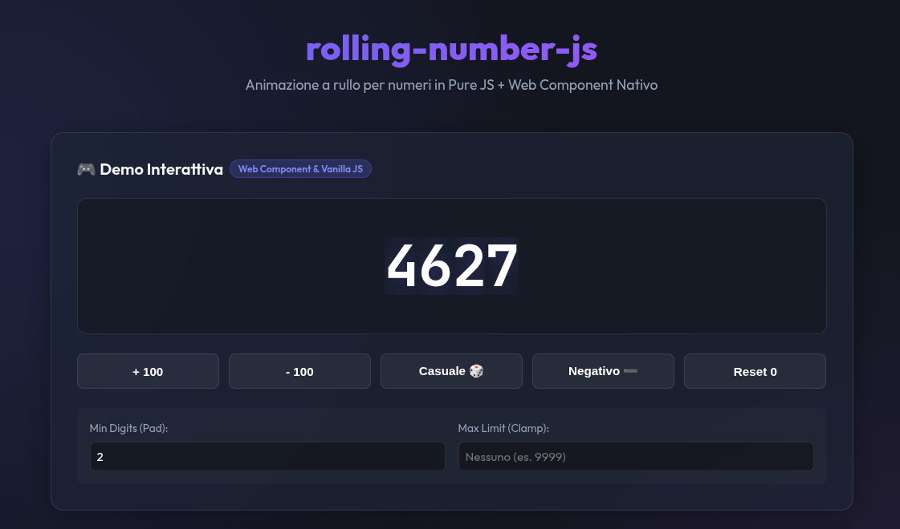

# 🎲 rolling-number-js

> An ultra-fast, zero-dependency, GPU-accelerated **Rolling Number Animation** library and native Web Component (`<rolling-number>`) for modern web applications.



<div align="center">

[](https://www.npmjs.com/package/rolling-number)
[](https://bundlephobia.com/package/rolling-number)
[](LICENSE)
[](#)
[](#)

</div>

---

## ⚡ Preview


---

## ✨ Features

- ⚡ **Ultra Fast & Lightweight**: Zero external runtime dependencies. Core package is **< 1.5 KB** gzipped.
- 🚀 **Hardware Accelerated (60 FPS)**: Powered by pure CSS `translateY` transitions on GPU compositor threads. No blocking `requestAnimationFrame` loops.
- 🌐 **Framework Agnostic**: Works natively in **React**, **Vue**, **Svelte**, **Angular**, **Solid**, or **Vanilla HTML/JS**.
- 🧩 **Dual Usage**: Use as a native HTML5 Custom Element (`<rolling-number>`) or via programmatic Vanilla JS Class (`RollingNumberCore`).
- ♿ **Accessible**: Built-in screen reader support (`role="img"`, dynamic `aria-label`, and decorative rungs marked with `aria-hidden="true"`).
- 🎨 **Fully Customizable**: Style font sizes, colors, duration, and easing curves using simple CSS variables.

---

## 📦 Installation

Install using **pnpm** (recommended), npm, or yarn:

```bash
# Using pnpm
pnpm add rolling-number

# Using npm
npm install rolling-number

# Using yarn
yarn add rolling-number
```

---

## 🚀 Quick Start

### 1. Web Component (`<rolling-number>`)

Register the web component once in your app entrypoint:

```typescript
import 'rolling-number/register';
import 'rolling-number/style.css';
```

Then use the custom element directly in your HTML or JSX/template:

```html
<rolling-number value="1234" pad="4"></rolling-number>

<!-- With max clamp limit (e.g., notification badge capped at 99) -->
<rolling-number value="150" pad="2" max="99"></rolling-number>

<!-- Negative numbers -->
<rolling-number value="-42" pad="2"></rolling-number>
```

### 2. Vanilla JavaScript / TypeScript API

```typescript
import { RollingNumberCore } from 'rolling-number';
import 'rolling-number/style.css';

const container = document.getElementById('counter-container');

// Instantiate
const counter = new RollingNumberCore(container, {
  value: 42,
  pad: 3,
  max: 999
});

// Update value programmaticly
counter.setValue(128);

// Update multiple options
counter.update({ value: 500, pad: 4 });

// Clean up
counter.destroy();
```

---

## 💻 Framework Examples

### React 19 / Next.js
```tsx
import { useEffect, useRef } from 'react';
import 'rolling-number/register';
import 'rolling-number/style.css';

export function Counter({ count }: { count: number }) {
  return <rolling-number value={count} pad={3} />;
}
```

### Vue 3
```vue
<script setup>
import 'rolling-number/register';
import 'rolling-number/style.css';
import { ref } from 'vue';

const count = ref(100);
</script>

<template>
  <rolling-number :value="count" pad="3" />
</template>
```

### Angular
```typescript
import { Component, input } from '@angular/core';
import 'rolling-number/register';
import 'rolling-number/style.css';

@Component({
  selector: 'app-counter',
  standalone: true,
  template: `<rolling-number [attr.value]="val()" pad="3"></rolling-number>`
})
export class CounterComponent {
  val = input<number>(0);
}
```

---

## ⚙️ API & Configuration

### Properties & Attributes

| Property / Attribute | Type | Default | Description |
| :--- | :--- | :--- | :--- |
| `value` | `number` | `0` | The numeric value to display and animate to. |
| `pad` | `number` | `1` | Minimum number of digit columns (pads leading zeros). |
| `max` | `number \| null` | `null` | Maximum value limit (e.g. `99` for notification counters like `99+`). |

### `RollingNumberCore` Class Methods

- **`setValue(value: number): void`**: Animates counter to new number.
- **`setPad(pad: number): void`**: Updates zero-padding minimum digit columns.
- **`setMax(max: number | null): void`**: Updates maximum clamping limit.
- **`update(options: RollingNumberOptions): void`**: Updates multiple options at once.
- **`destroy(): void`**: Cleans up DOM nodes and event listeners.

---

## 🎨 Customization (CSS Variables)

Customize transition timing, animation easing, and font styles directly through CSS variables:

```css
rolling-number, .rn-rolling-number {
  /* Animation Speed & Easing Curve */
  --rn-duration: 0.6s;
  --rn-easing: cubic-bezier(0.34, 1.56, 0.64, 1); /* Bounce easing */

  /* Typography */
  font-family: 'JetBrains Mono', monospace;
  font-size: 3rem;
  color: #6366f1;
}
```

---

## 📄 License

[MIT](./LICENSE) © Erlon Rr
